<picture>
  <source media="(max-width:600px)" srcset="assets/header-mobile.svg">
  
</picture>

I’m an **AI researcher and engineer** working across language generation, model training, evaluation, and interactive AI systems. I build across the stack: from data preparation and model adaptation to experiments, inference pipelines, and applications people can use.

At **IIIT Hyderabad’s Language Technologies Research Center (LTRC)**, I work with **Prof. Radhika Mamidi** on computational creativity and language model evaluation. My broader engineering work includes **Mixture-of-Experts architectures, multi-agent learning systems, offline RAG, and generative storytelling**. Previously, I worked as an **NLP Engineer at Olive Orange**, building an educational RAG system with local models.

### Presentation sensitivity in typed decision models
*Current study · Model evaluation*

How much does a model’s judgment change when the same text is presented differently? An audit of **Jev, Clef Flash, and Perplexity Decider** across humor, helpfulness, and summarization: **9,000 items, six datasets, and 702,000 recorded judgments**. The release separates repeatability, presentation robustness, and agreement with people, and includes predictions and offline result reproduction.

[Manuscript](https://github.com/J10Official/Presentation-Sensitivity-in-Typed-Decision-Models-for-Subjective-Text-Evaluation/blob/main/paper/output/current/manuscript.pdf) · [Code & results](https://github.com/J10Official/Presentation-Sensitivity-in-Typed-Decision-Models-for-Subjective-Text-Evaluation)

### Does Bigger Mean Funnier?
*Published · CHum 2026 · Jatin Agrawal & Radhika Mamidi*

**Evaluating Humor Generation Across the Qwen3 Model Family.** A study of how model scale relates to humor quality across **five Qwen3 models, from 8B to 235B parameters**, using human and automated evaluation.

[Paper](https://aclanthology.org/2026.chum-1.7/) · [Code](https://github.com/J10Official/Humor-Parameter-Ablation)

### Neurosymbolic humor generation
*Published · SemEval 2026 · Task 1*

**GTVH-Guided LLM Decomposition · j10official at SemEval-2026 Task 1.** A five-stage **DSPy pipeline** that translates humor theory into a structured generation process. **Second place in both Chinese humor generation and GIF fill-in-the-blank.**

[Paper](https://aclanthology.org/2026.semeval-1.379/) · [Code](https://github.com/J10Official/Semeval2026_Task1)

Hugging Face Transformers · DSPy · PEFT / LoRA · RAG · Mixture-of-Experts

---

Research collaborations & applied AI projects  
**[jatin.agrawal@research.iiit.ac.in](mailto:jatin.agrawal@research.iiit.ac.in)**

