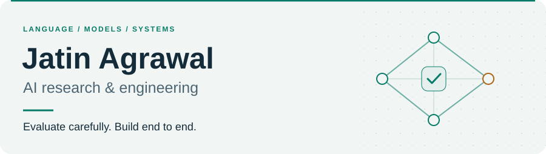

<picture>
  <source media="(max-width: 600px) and (prefers-color-scheme: dark)" srcset="assets/header-mobile-dark.svg">
  <source media="(max-width: 600px)" srcset="assets/header-mobile-light.svg">
  <source media="(prefers-color-scheme: dark)" srcset="assets/header-dark.svg">
  
</picture>

  <a href="https://scholar.google.com/citations?user=Pvycwx0AAAAJ&amp;hl=en"><b>Publications</b></a> &nbsp; / &nbsp;
  <a href="https://huggingface.co/J10Official"><b>Models</b></a> &nbsp; / &nbsp;
  <a href="https://www.linkedin.com/in/jatin-agrawal-iiith/"><b>LinkedIn</b></a> &nbsp; / &nbsp;
  <a href="mailto:jatin.agrawal@research.iiit.ac.in"><b>Email</b></a> &nbsp; / &nbsp;
  <a href="https://j10-official.itch.io/"><b>Play</b></a>

I research how AI systems generate language, make judgments, and behave when their inputs change. I also build the systems around them: training pipelines, evaluation tools, learning applications, and interactive experiences.

At **IIIT Hyderabad’s Language Technologies Research Center (LTRC)**, I work with **Prof. Radhika Mamidi** on language generation and evaluation. My work connects controlled experiments and human judgments with implementations that others can inspect, reproduce, and build on.

<picture>
  <source media="(max-width: 600px) and (prefers-color-scheme: dark)" srcset="assets/evidence-mobile-dark.svg">
  <source media="(max-width: 600px)" srcset="assets/evidence-mobile-light.svg">
  <source media="(prefers-color-scheme: dark)" srcset="assets/evidence-dark.svg">
  
</picture>

## Research focus

### When the text stays the same, does the judgment?

**[Presentation Sensitivity in Typed Decision Models for Subjective Text Evaluation](https://github.com/J10Official/Presentation-Sensitivity-in-Typed-Decision-Models-for-Subjective-Text-Evaluation)**

My current study audits **Jev, Clef Flash, and Perplexity Decider** across humor, helpfulness, and summarization: **9,000 items, six datasets, and 702,000 recorded judgments**. It tests whether order, identifiers, contextual cues, and rating formats change decisions—and separates repeatability, robustness, and agreement with human judgments.

The public release includes the manuscript, experiment code, recorded predictions, and offline result reproduction.

**[Read the manuscript ↗](https://github.com/J10Official/Presentation-Sensitivity-in-Typed-Decision-Models-for-Subjective-Text-Evaluation/blob/main/paper/output/current/manuscript.pdf)** &nbsp; · &nbsp; **[Explore code & results ↗](https://github.com/J10Official/Presentation-Sensitivity-in-Typed-Decision-Models-for-Subjective-Text-Evaluation)**

### Published work

**[Does Bigger Mean Funnier? Evaluating Humor Generation Across the Qwen3 Model Family](https://aclanthology.org/2026.chum-1.7/)** 
CHum 2026 · Jatin Agrawal & Radhika Mamidi

A controlled study of five Qwen3 models, from 8B to 235B parameters, comparing humor quality through human and automated evaluation. 
[Paper ↗](https://aclanthology.org/2026.chum-1.7/) &nbsp; · &nbsp; [Code ↗](https://github.com/J10Official/Humor-Parameter-Ablation)

**[Neurosymbolic Humor Generation via GTVH-Guided LLM Decomposition](https://aclanthology.org/2026.semeval-1.379/)** 
j10official at SemEval-2026 Task 1 · SemEval 2026

A five-stage DSPy pipeline grounded in humor theory. **Second place in Chinese humor generation and GIF fill-in-the-blank.** 
[Paper ↗](https://aclanthology.org/2026.semeval-1.379/) &nbsp; · &nbsp; [Code ↗](https://github.com/J10Official/Semeval2026_Task1)

## From models to working systems

### 01 / [AI Visual Novel ↗](https://github.com/J10Official/AI_Visual_Novel)

A collaborative project connecting model training to a playable browser experience: screenplay data preparation, QLoRA adaptation, generation evaluation, and a React visual-novel engine.

DATA → FINE-TUNING → EVALUATION → INTERFACE

### 02 / [Mixture-of-Experts ↗](https://github.com/J10Official/MoE)

Implemented and compared learned and hash routing, including a four-expert, top-2 sparse model. Released six model variants with evaluation artifacts and a technical report.

[MODEL WEIGHTS ON HUGGING FACE ↗](https://huggingface.co/J10Official)

### 03 / [Personalized Tutor ↗](https://github.com/J10Official/AoLM-Personalized-Tutor-Final-Submission)

A collaborative learning system with six DSPy agents, a 171-concept prerequisite graph spanning seven courses, persistent learner state, and learner/admin interfaces.

AGENT WORKFLOWS · KNOWLEDGE GRAPHS · FULL STACK

### 04 / [Hitori ↗](https://github.com/J10Official/Hitori)

A short, independently developed RPG Maker MZ game about bullying and the bystander effect. Dual perspectives make the narrative something the player experiences through choices.

[PLAY THE GAME ↗](https://j10-official.itch.io/hitori) · BUILD & DESIGN REPORT IN THE REPOSITORY

## Experience & community

- **Applied AI:** Previously an NLP Engineer at **Olive Orange**, building an offline educational RAG system around curriculum content and local models.
- **Research community:** Session chair for **NLP Applications at ACL 2026**.
- **Teaching through building:** Game Development Head at **The Gaming Club, IIIT Hyderabad**, mentoring **100+ students** in game development.

## Technical range

| Research & modeling | Systems & applications | Interactive work |
| :--- | :--- | :--- |
| Python · PyTorch · Transformers DSPy · PEFT / LoRA · RAG | C / C++ · TypeScript · React FastAPI · Linux · Docker · Git | RPG Maker MZ Game systems · Narrative design |

<b>Background & recognition</b>

 

I’m pursuing a **B.Tech in Computer Science and MS by Research in Computational Linguistics at IIIT Hyderabad** (expected 2028). Recognition includes the **Dean’s List (2023–2026)** and **Research Excellence List (2026)**.

I was also selected for **P&G Spotlight**, among **16 participants from 1,200+ applicants**.

 

<picture>
  <source media="(max-width: 600px) and (prefers-color-scheme: dark)" srcset="assets/playground-mobile-dark.svg">
  <source media="(max-width: 600px)" srcset="assets/playground-mobile-light.svg">
  <source media="(prefers-color-scheme: dark)" srcset="assets/playground-dark.svg">
  
</picture>

For research collaborations, applied AI projects, or an interesting problem: <a href="mailto:jatin.agrawal@research.iiit.ac.in">jatin.agrawal@research.iiit.ac.in</a>

